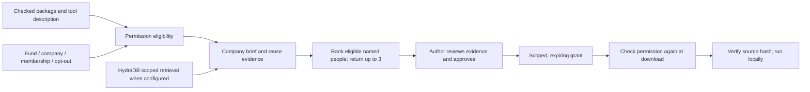

# Five-minute rehearsal and real Devpost footage

This supersedes the timing and extension-version instructions in older demo runbooks. The five-minute mock is a narrated practice guide, not proof that two production laptops completed the flow. Its app screens are captured from the current UI using real local API handlers and isolated fictional accounts. The native folder picker and factory overview are illustrations. The original generated telemetry inspector remains the evidence of live code generation; the other four projects are prepared reference tools.

## The scenario

Anushka represents an ocean-survey support team inspired by **Saildrone**. Connor represents a residential-solar service team inspired by **Palmetto**. The local rehearsal names them `Saildrone (demo)` and `Palmetto (demo)`. Existing production workspaces remain **Pelagic Robotics** and **Helioforge Energy**; there is no need to recreate them. State the analogy once rather than implying real company membership, endorsement, or customer deployment.

Saildrone publicly describes ocean mapping and mission operations: https://www.saildrone.com/capabilities/ocean-mapping and https://www.saildrone.com/news/saildrone-mission-management . Palmetto publicly offers monitoring, troubleshooting and field service: https://palmetto.com/request-service/maintenance-and-repair and https://palmetto.com/request-service/troubleshoot-your-monitoring-system . The following workflows are proposed illustrations, not documented internal workflows.

| Working project | Survey-team interpretation | Solar-team interpretation |
| --- | --- | --- |
| Weather window planner — main handoff | Schedule **shore-side crew/instrument servicing** ahead of a survey, using supplied conditions and task limits. Do not describe 8 m/s as a Saildrone vehicle operating limit. | Identify candidate slots for a solar service visit under that team's own illustrative wind/rain limits. The tool does not certify safe roof work. |
| Revenue reconciler | Reconcile illustrative survey-service invoices with received payments. | Reconcile illustrative service-job invoices with payments. Neither demo connects to real billing or moves money. |
| Battery test reviewer | Screen synthetic bench-test reports for battery packs used in marine equipment. | Illustrate the same screening for energy-storage equipment; not a claim about Palmetto's internal battery qualification process. |
| Inference capacity planner | Compare synthetic compute options for processing instrument observations. | Compare synthetic options for a monitoring/anomaly service. These are hypothetical workloads, not measured company infrastructure or vendor benchmarks. |

Only weather is walked through end to end. Show the other three names for 15 seconds.

## The selective identification architecture that exists today



There is **no separate Jev integration/classifier** in the repository. Recommendations use permission-filtered workflow keywords and recorded reuse, augmented by HydraDB retrieval when configured and above its threshold. Hydra is not the permission authority. Names/evidence are returned only for eligible suggestions. Same-company and cross-company grants both exist.

The implementation identifies need mainly at **company level**, then recommends eligible people in that company; it does not yet model each employee's individual tasks. It ranks declared descriptions and evidence, not arbitrary code semantics. A matching schema alone is not evidence of usefulness. The result is a recommendation, never an automatic share.

Prepared decision projects use `decision-report/v1`, not CSV-column rebinding. The original inspector uses the sensor mapping. All seven local check records are supplied to the hosted service; the hosted API does not independently rerun them or offer remote execution attestation.

## Demonstrate selectivity without contaminating production

Run from the repo:

```sh
npm run build
node scripts/rehearse-routing.mjs
# Keep a fresh browser-based rehearsal open:
node scripts/rehearse-routing.mjs --serve
```

The script uses the real API handlers, real project workers and an ephemeral local database. It prints separate Anushka/Connor local login links; open them in separate browser profiles/private windows. It never loads `.env`, disables live Hydra in this fixture, creates no hosted accounts, and cannot delete production companies. Ctrl-C clears this isolated database. A new invocation starts clean. This browser sandbox is separate from your signed-in production IDEs.

Its five companies are the source survey team plus these four possible recipients:

| Fictional recipient | Brief / policy | Expected behavior |
| --- | --- | --- |
| Palmetto (demo), Connor | Solar service visits depend on wind/rain and an uninterrupted work slot | Recommended |
| Ledgerline SaaS, Mira | Match invoices to receipts and unpaid balances | Not recommended |
| Tensor Forge, Dev | Size GPU clusters against throughput, latency and budget | Not recommended |
| Skylark Field Systems, Rae | Relevant outdoor operations, but receiving turned off | Excluded before ranking |

Automated counterfactuals change Mira's brief and verify the recommendation changes; toggle Rae's preference and verify permission overrides relevance. The test also confirms that a recommendation alone gives no code access, the approved download preserves source, unrelated accounts are denied, and changing weather limit 8 → 4 changes 2 candidate windows → 0. This demonstrates a functioning rule/evidence pipeline, not measured semantic-retrieval accuracy. The four-row audit is a rehearsal explanation, not a production UI that reveals opted-out users.

## Production preflight — offstage

1. Both machines install **0.1.6**, reload their editor, and verify their own working company. Connor deploys the corresponding `site/` update after `npm run package:site`.
2. Keep the fund, companies, permissions, mappings and original completed inspector. Do not purge the database.
3. Save truthful illustrative briefs if using the weather story:
   - Source: `Plan shore-side instrument servicing ahead of ocean surveys. We need uninterrupted work windows around wind, rain and task duration.`
   - Recipient: `Schedule solar service appointments around wind and rain, keeping a continuous two-hour work slot.`
4. Anushka: Start → **Add four examples to my company… → Create fresh rehearsal copies**. In the recipient picker, keep only **My team** checked. **Do not select Connor yet.** This creates new checked records with a rehearsal suffix while preserving all older projects. The ordinary reuse option remains idempotent.
5. Open the new weather record in the company dashboard. Confirm Connor is actually suggested under **Who should get it next**. If absent, fix the brief/receiving/export settings before recording. Do not substitute a manual recipient selection and call it a recommendation.
6. Why fresh copies matter: an active grant or recorded adoption suppresses repeat suggestions. Revoking a downloaded tool's grant alone does not reset its reuse history. Rehearse on one copy; prepare another fresh copy for the final take.
7. Connor may clear local extension history before the last rehearsal, but that signs him out. It does not erase hosted reuse history or downloaded folders. Sign back in offstage; never clear it during the presentation.
8. Create an easy-to-find local parent folder named `Common Ground Rehearsal`. Trust the workspace before running code. Close private tabs, terminals with secrets, and notifications before recording.
9. Run each prepared tool once. Weather baseline must show **2 windows, 5 usable hours, 2 excluded hours**. Wind limit 4 must show **0 windows, 0 usable hours, 5 excluded hours**. These values use synthetic inputs, not live weather.
10. Keep the actual completed inspector build visible in another tab for its requirement, code and checks. Do not start a slow new build on stage.

## Five-minute beat sheet

| Time | Operator | Action |
| --- | --- | --- |
| 0:00–0:20 | Both | Introduce the two example teams; setup already complete. |
| 0:20–0:45 | Anushka | Show original completed inspector build/checks as factory evidence. |
| 0:45–1:20 | Anushka | Weather preview → Run project → two candidate windows. |
| 1:20–1:40 | Anushka | Explain the four recipient cases using the fictional rehearsal audit. |
| 1:40–2:15 | Anushka | Dashboard → fresh weather tool → read evidence → **Share beside Connor**. |
| 2:15–2:50 | Connor | Correct working company → Refresh companies → shared weather tool → Open in editor. |
| 2:50–3:20 | Connor | Choose parent folder → Save project here → **new editor window** → Command Palette → Common Ground: Open Start → **Opened from Common Ground → Open project**. |
| 3:20–3:40 | Connor | Verify **Downloaded shared project** label; Run project. |
| 3:40–4:15 | Connor | Change maximum wind 8 → 4; Run project; explain zero qualifying two-hour windows. |
| 4:15–4:25 | Connor | Expand Assumptions and evidence; show source hash. |
| 4:25–4:40 | Anushka | Show four-project collection briefly. |
| 4:40–5:00 | Both | Close on checked code reaching the next authorized user. |

The diagram/audit is an explanation. Do not imply the extra fictional accounts exist in your live production fund. For the two-laptop handoff, show your actual companies and actual returned recommendation.

## Two-laptop recording for Devpost

Record separately and edit together. The same **fresh weather tool name/version** must appear in both recordings. No remote-desktop setup is required.

**Anushka records:** completed inspector evidence, weather baseline, actual recommendation and evidence, approval. Leave a three-second hold before and after each click. Record each shot at normal speed; any shortened generation wait gets an `Earlier completed build` / `Wait shortened` caption in the edit.

**Connor records:** correct company and inbox before receiving; refresh after Anushka says `shared`; open the actual share; folder picker; new-window transition; Open Start; downloaded project; baseline; changed input; recalculated result; source hash. Keep recording across the handoff. If something fails, keep the clip, fix it, and record a clearly separate successful take.

Use macOS **Shift-Command-5 → Record Selected Portion**, frame just the IDE/browser, save to `artifacts/demo-takes/`, and stop from the menu bar. This is the simplest capture option and works without installing ffmpeg. No microphone needed; narration is recorded once over the final edit.

Optional command-line capture (ffmpeg installed, screen-recording permission granted):

```sh
bash scripts/demo-capture/record.sh --list
# Substitute the index actually labelled Capture screen, not a camera.
bash scripts/demo-capture/record.sh anushka SCREEN_INDEX 180
# On Connor's laptop:
bash scripts/demo-capture/record.sh connor SCREEN_INDEX 180
```

The script has a five-second countdown, records a cursor and no microphone, and writes an ignored local MP4. No uploads. `q` in its terminal ends recording early. If macOS requests screen-recording permission, approve it in System Settings and restart the recording app if required; the script cannot bypass that permission.

Transfer Connor's original recording **by AirDrop** to Anushka's Mac (both laptops are together), then place it under `artifacts/demo-takes/`. A shared Drive upload is an alternative; do not send large videos through Git. Name the files `anushka-TAKE.mp4` and `connor-TAKE.mp4`, and retain raw originals.

The provided rules require a *short* demo video but do not specify a maximum in the pasted text. Aim for a **2:30–2:45 submission cut**, distinct from the 5-minute stage rehearsal; check the actual submission field before uploading. Suggested edit: 15s problem, 25s completed factory evidence, 25s selective match/approval, 45s recipient opening/execution, 25s changed result/hash, 15s other examples, 15s close. Use actual footage throughout the proof section. The mock rehearsal is not the submission.

The assembly helper accepts explicit time ranges from real footage and optional narration. It refuses missing clips, invalid trim ranges and existing output paths:

```sh
# Copy scripts/demo-capture/manifest.example.json beside the recordings.
# Replace paths/times with the actual chosen takes; optionally add "narration": "voiceover.m4a".
python3 scripts/demo-capture/assemble.py artifacts/demo-takes/manifest.json
```

This helper normalizes to 1080p/30fps, adds an operator subtitle track and concatenates approved takes. It does not choose the good moments or fabricate missing footage. Once both raw recordings are on Anushka's machine, the agent can inspect them and make the final cut. Devpost upload/publication remains a separate step.

## Recovery cues

- No share visible: verify working company, click **Refresh companies**, allow a few seconds. Do not switch to the prepared preview and present it as a download.
- A new editor window opens: this is expected. Open Common Ground there and use **Opened from Common Ground**.
- No recommendation: prior share/adoption may suppress it; use fresh rehearsal copies. Otherwise check saved briefs and permissions. Do this before recording.
- Local builder is off: receiving/running these prepared projects does not need it. A new live generation does.
- Website shows old contract/check labels: deploy the matching site build. The latest API distinguishes JSON decisions from sensor mappings.
- Network interruption during the live handoff: disclose it and show a previously downloaded copy or a genuine recorded handoff. Never imply that a bundled preview just arrived from the other laptop.
